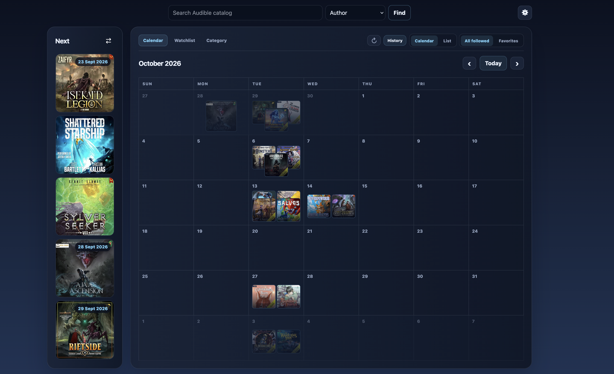

# AudibleCalendar

AudibleCalendar is a self-hosted web app for tracking audiobook releases. Follow
Audible authors, series, or standalone books and see their releases in a calendar
or list. It uses public catalog data, so no Audible account is required.

- Search Audible and build a personal watchlist.
- Follow all releases from an author, selected series, or individual standalone books.
- View upcoming and previous releases, mark favorites, and browse categories.
- Refresh automatically on a schedule or manually when needed.
- Create multiple user accounts with separate watchlists and settings.
- Export and import your catalog, settings, and cached covers.

Audible is the source of truth for released and upcoming books. Optional Audnexus
enrichment fills missing details. Catalog responses and public artwork are cached and
shared across users to reduce requests to Audible. Imported artwork stays scoped
to its account and HTTP image responses use private revalidation.



## Installation

Download or clone this repository, then open a terminal in its directory. Choose
**native Python or Docker**; both provide the same app and store data locally in
SQLite. No Node.js installation, frontend build, or external database is needed.

The instructions below are for a new installation. When updating, keep your
existing `.env` and data directory; see [updating and backups](#updating-and-backups).

### Install without Docker

Requires Python 3.13 or 3.14. The repository includes native setup and run scripts for
macOS, Linux, and Windows PowerShell. Each script creates or uses
`.venv`, creates `.env` from `.env.example` without overwriting an existing
configuration, and prepares `.data/` for local data.

These platform-specific installation scripts are largely untested and may
require adjustment for your system.

On macOS:

From the extracted repository directory, remove macOS's quarantine attribute
from the downloaded files before running the scripts:

```sh
xattr -dr com.apple.quarantine .
sh ./scripts/install-macos.sh
sh ./scripts/run-macos.sh
```

If `xattr` or the scripts report `Operation not permitted`, check that your
terminal has access under System Settings → Privacy & Security → Files and
Folders. Alternatively, extract the repository into a folder such as
`~/Projects` and retry the commands there. If you move an existing installation,
delete its `.venv` and run the installer again to recreate it at the new path.

On Linux:

```sh
./scripts/install-linux.sh
./scripts/run-linux.sh
```

On Windows, open PowerShell in the repository directory. If PowerShell blocks
local scripts, allow them only for that process:

```powershell
Set-ExecutionPolicy -Scope Process Bypass
.\scripts\install-windows.ps1
.\scripts\run-windows.ps1
```

For example, to listen on all interfaces on port 8000, use
`.\scripts\run-windows.ps1 -BindAddress 0.0.0.0 -Port 8000` and put the
installation behind HTTPS before making it reachable outside the machine.

The Windows installer uses `requirements.windows.lock`, which omits the Linux
and macOS-only `uvloop` package. The application itself is the same on all
three platforms; Windows does not require WSL2. If you prefer WSL2, use the
Linux scripts inside the WSL environment instead.

The run scripts use `AUDIBLECALENDAR_BIND` and `AUDIBLECALENDAR_PORT` from
`.env`, defaulting to `127.0.0.1` and `8000`. You can also override them for one
run on macOS/Linux, for example:

```sh
./scripts/run-linux.sh --host 0.0.0.0 --port 8000
```

Open [http://127.0.0.1:8000](http://127.0.0.1:8000). Data is created in `.data/`.
Keep the terminal running; press Ctrl+C to stop the server. For a background
service, see [running as a service](#running-as-a-service).

The scripts are convenience wrappers around the same manual commands. If you
need to run them directly:

```sh
python3 -m venv .venv
.venv/bin/python -m pip install -r requirements.lock
cp .env.example .env
.venv/bin/python scripts/run_native.py
```

### Install with Docker

Requires Docker Engine or Docker Desktop with Docker Compose v2.

The `compose.yml` file defines the standalone installation.

```sh
mkdir -p .data
```

The container runs as UID/GID `10001:10001` and needs write access to `.data`.
On Linux, prepare the new directory before starting:

```sh
sudo chown 10001:10001 .data
```

Docker Desktop normally handles bind-mount access for you.

Start the app:

```sh
docker compose up -d --build
```

Open [http://127.0.0.1:8000](http://127.0.0.1:8000). The setup binds to
localhost and stores data in `./.data`. Data survives container replacement.
The container does not restart automatically after Docker or the host restarts;
run `docker compose up -d` again to start it.

Useful commands:

```sh
docker compose logs --tail=100
docker compose stop
docker compose up -d
```

## First use

For both native and Docker installations, log in with username **`admin`** and
password **`admin`**. On first login, the app requires you to set a new password
in **Settings → Users** before you can use the catalog or administrative features.
The new password must contain 12–256 characters. Existing accounts keep their
passwords; accounts still using `admin` must change it before continuing.
The initial account is the only administrator and can add regular
accounts in Settings → Users. It cannot be disabled or demoted. On upgrade,
existing secondary administrators become regular users and must sign in again.
Choose your Audible region in Settings before following anything.

Search for an author, series, or book and follow the results you want to track.
Following an author includes their series and standalone books. Books within a
series are tracked through that series; standalone books can be followed
individually. You can exclude releases from an author follow without unfollowing
the author entirely.

Following a book does not automatically follow every credited author. When a
book has additional contributors, the app asks which of them should also be
followed; choosing none keeps the follow scoped to the book, or to the current
author when selected from that author’s page. Removing an author
or removing a book from one author's scope leaves other authors' follows intact.

The calendar opens on Favorites by default; choose All followed to see every
followed release. Change the default in Settings → App. History loads the last
year on demand; navigate to an older month or use **Load an earlier year** in
list view to expand it. The Last release tiles fetch only the five most recent
matching releases. Use favorites to narrow
the view, and open an item for its details and Audible link. Category browsing is
separate from your watchlist and does not automatically follow anything.

## Configuration and sync

Use Settings to choose your Audible marketplace, date format, time zone, language
filter, sync schedule, and cache preferences. New installations default to the US
store and US date format. During initial setup, new installations use the browser's
time zone unless `AUDIBLE_TIME_ZONE` explicitly sets a default. The zone is saved
with setup; later browser changes and upgrades do not override saved settings.
If browser detection is unavailable, the fallback is Los Angeles. Supported regions are `us`, `uk`, `ca`,
`au`, `de`, `fr`, `es`, `it`, `jp`, `in`, and `br`.

Choose the region you normally use. Each user has a separate library database
for each region: follows, exclusions, favorites and author matches never
transfer between regions. A new region starts empty; returning to a previous
region restores its library. Only the selected region syncs automatically.
Login and general settings stay with your account.

Automatic sync is enabled by default and runs every 24 hours. Both scheduled
and manual sync request fresh catalog discovery pages, including releases from
the past 30 days to catch late listings, while reusing cached product metadata.
Discovery remains bounded by pagination limits; incomplete checks are reported.
Opening author/series details also saves discovered books and reloads the local
calendar, subject to its follow, favorite and History filters. Browsing the
calendar reads local data. Settings shows sync status and source errors. Known
non-English releases are filtered by default, and books without a usable release
date do not appear in the calendar.

Detail views refresh as their cache expires; **Refresh from Audible** checks one
item immediately. Audible requests are paced across all users, with a brief
cooldown after upstream failures. Cached data remains available during a cooldown.

[.env.example](.env.example) lists native-install environment options. Saved
in-app settings take precedence over environment defaults. Native Python loads
`.env` through Uvicorn's `--env-file` support. The standalone Docker Compose
file uses fixed defaults and does not pass `.env` into the container; change
app preferences in Settings.

Common native-install options:

| Option | Purpose | Default |
| --- | --- | --- |
| `AUDIBLECALENDAR_DB` | Native Python database path | `.data/audiblecalendar.db` |
| `AUDIBLECALENDAR_PORT` | Native run-script port | `8000` |
| `AUDIBLECALENDAR_BIND` | Native run-script listen address | `127.0.0.1` |

Other environment-backed defaults, including cache and sync settings, are
documented in `.env.example`.

Docker always stores its databases under `/data` inside the container. Keep data
on local storage rather than a network filesystem.

## Running as a service

Run one application process per installation, without development reload or
multiple workers sharing the same data directory.

Docker runs in the background. For native hosting, configure your service
manager to run the platform script from this installation, such as
`/absolute/path/to/AudibleCalendar/scripts/run-linux.sh` with systemd or
`/absolute/path/to/AudibleCalendar/scripts/run-macos.sh` with launchd. These
scripts use the installation's `.venv`, `.env`, and `.data`; run the service as
the account that owns and can write to that data directory. No service unit or
launchd plist is included.

For access beyond this computer, bind to a suitable LAN address or put the app
behind an HTTPS reverse proxy. With a proxy, set `FORWARDED_ALLOW_IPS` to its IP
or trusted private subnet so forwarded scheme and client addresses are handled
correctly. Avoid `*` on an exposed application port.

## Updating and backups

Before updating, stop the app and copy the **whole data directory**. It contains
accounts, user databases, shared caches, artwork, and backups. A single database
file is not a complete installation backup.

- **Native Python:** stop the server, back up, update the code, run
  `.venv/bin/python -m pip install -r requirements.lock`, and restart using the
  installation command or your service manager.
- **Docker:** run `docker compose stop`, back up, update the code, then run
  `docker compose up -d --build`.
  Keep the same `.data` directory.

To move your regional library, use Settings → Database transfer. Exports include
the selected region's catalog, follow preferences, account settings, and
available cached covers. Select the same region at the destination before
importing. Import creates a backup, replaces that region's library and restores
account settings; other regions and your login remain unchanged.

A full-directory restore must retain the same application-visible data path
(`/data` in Docker). To change native paths or move between native Python and
Docker, create accounts at the destination and use per-user export/import.

The current catalog schema is 9. Schemas 6, 7 and 8 upgrade automatically at startup
with a backup; older schemas and the previous single-user layout are unsupported.
Existing per-user databases split into regional libraries automatically, keeping
the original database as a backup. Records stay in their recorded marketplace;
no follows are copied. Imports require a current regional export, so update an
older installation before exporting.

If the app cannot write to its database, check the data directory's ownership
and permissions. For Docker, check `docker compose logs --tail=100`; for a native
service, check its service logs. `/api/health` is a process liveness check. `/api/ready` returns 503 when the
scheduler is unavailable or a user's scheduled workspace checks are failing.
Settings → Sync shows errors for the current account. Failed/partial syncs retry
after five minutes; cached fallback data does not advance the last-successful
check time. Overlapping manual and scheduled sync requests share one run.
Discovery that reaches its page limit is reported as incomplete.

## Storage and privacy

Outbound requests go to the selected Audible marketplace, approved artwork
hosts, and optionally Audnexus. They contain catalog identifiers/search terms,
not your local login credentials. Audible and Audnexus are independent services;
this app does not provide an availability guarantee for their public endpoints.

Automatic cleanup is **on by default**. The administrator can
control it in **Settings → Cache** for both native and Docker installations.
Response retention defaults to **28 days**. Image retention defaults to **99999 days**,
and image expiry by age is off by default; it has its own toggle and retention
period. The default size limits are **256 MiB**
of responses per database and **1 GiB** of artwork across libraries; set either
limit to 0 for unlimited storage. All backups are kept by default. These settings
apply to the whole installation.

Settings → Cache shows current response and cover-image usage across all accounts
and libraries. Response usage counts cached payloads and keys; image usage sums
the stored cover files.

Cleanup removes cached responses older than their configured retention period.
When image expiry is enabled, it also removes artwork older than its separately
configured retention period. Disabling image expiry leaves the artwork size limit
in effect. Image age is measured from when the file was saved. This includes
imported cached covers. It can also prune older pre-import backups if you set a
positive backup count. Cleanup runs while idle, roughly every six hours; requests
may briefly need to retry. It never removes followed authors, series, or books.
The freshness controls determine when cached data is refreshed, independently
of these deletion settings. Previous cleanup environment variables are no longer
used; configure cleanup in the app.

The administrator can also use **Clear cache** in Settings → Cache. Check
**Automatic cleanup** to delete cached catalog responses and detail snapshots,
and check **Image expiry by age** to delete cover images for all accounts,
including imported covers. The button stays disabled when neither box is
checked. Books, follows, favorites, settings, accounts and backups are kept.
Online data is fetched again as needed; restoring deleted imported covers may
require the original export.

Migration backups and original pre-region-split databases are always retained.
Review them manually after verifying your full-directory backup. Disabling an
account revokes access but keeps its libraries and backups; it is not data deletion.
Exports include regional library and preference data, so share them deliberately.
Category CSV exports prefix formula-like text with an apostrophe for spreadsheet safety.

## Licence

Source-available under [PolyForm Noncommercial 1.0.0](LICENSE), for
noncommercial use. This is not an OSI-approved open-source licensed project.
AudibleCalendar is not affiliated with Audible.
